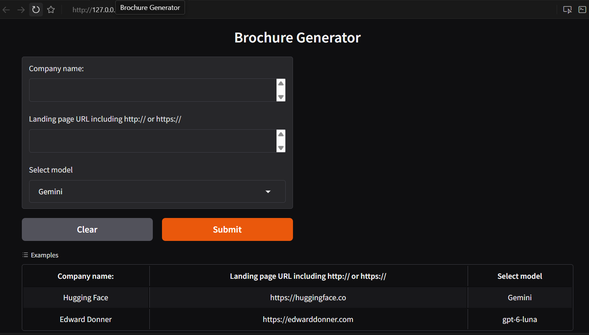
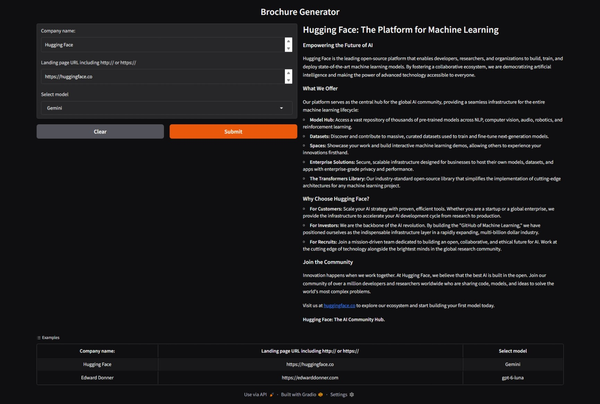

# AI Brochure Generator

An AI-powered brochure generation application built using Python, Gradio, and Google Gemini API.

## Overview

AI Brochure Generator creates professional company brochures using Generative AI. Users provide a company name and website URL, and the application generates a brochure that can be used for customers, investors, and potential employees.

This project was developed while learning AI application development and demonstrates the integration of Large Language Models (LLMs) with a web-based user interface.

## Features

- Generate professional company brochures
- Powered by Google Gemini API
- Interactive Gradio user interface
- Streaming AI responses
- Markdown-based brochure output
- Simple and easy-to-use workflow

## Tech Stack

- Python
- Gradio
- Google Gemini API
- OpenAI Python SDK
- Python Dotenv

## Project Structure

```text
AI-Brochure-Generator/
├── app.py
├── requirements.txt
├── README.md
├── .gitignore
└── screenshots/
    ├── home.png
    └── output.png
```

## Installation

Clone the repository:

```bash
git clone https://github.com/Haravind_Y/ai-brochure-generator.git
cd ai-brochure-generator
```

Install dependencies:

```bash
pip install -r requirements.txt
```

## Environment Variables

Create a `.env` file in the project root directory:

```env
GOOGLE_API_KEY=your_google_api_key
```

## Running the Application

```bash
python app.py
```

After launching, open the local Gradio URL in your browser.

## Screenshots

### Home Screen



### Generated Brochure



## Sample Workflow

1. Enter the company name.
2. Enter the company website URL.
3. Click Generate.
4. Review the AI-generated brochure.
5. Copy or useuture Improvements

- PDF export support
- Website content scraping
- Multiple brochure templates
- Additional LLM integrations
- Improved UI design
- Download brochure functionality

## Learning Outcomes

Through this project, I practiced:

- Python application development
- Prompt engineering
- API integration
- Gradio interface development
- Environment variable management
- Git and GitHub workflows

## Author

**Haravind Yarramareddy**

GitHub: https://github.com/Haravind_Y